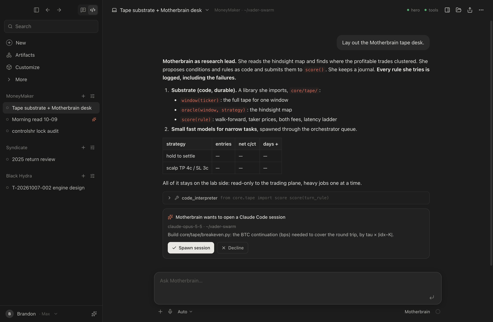

# Motherbrain Code

A desktop app modelled on the Claude Code desktop app. One window, two engines:

- **Motherbrain**: the hero on Mind (`mlx-community/Qwen3.5-397B-A17B-4bit`, OpenAI-compatible at `localhost:8100/v1`), with her sandboxed tools from mb-tools (`localhost:8140`: `code_interpreter`, `read_file`, `recall_memory`), plus one app-side tool, `spawn_claude_session`.
- **Claude Code**: the local `claude` CLI (`~/.local/bin/claude`) driven through `@anthropic-ai/claude-agent-sdk`. It uses the CLI's existing login, so it runs on the signed-in subscription. Sessions are written to `~/.claude/projects` and can be resumed from the terminal (`claude --resume <id>`).



## Architecture

```
renderer (React + Tailwind, sandboxed)            main process (Electron, Node)
  Sidebar · Transcript · Composer   <── IPC ──>    engine:send → claude.ts | motherbrain.ts
  state.ts applies EngineEvents                    engine:event (stream) ← both engines
  cards: permission / spawn  ── decision:respond → bridge.ts resolves the awaiting engine
  saveState (debounced)      ── state:save ─────→ store.ts → <userData>/state.json
```

- `shared/types.ts`: models, modes, the transcript block model, and the `EngineEvent` stream contract.
- `electron/claude.ts`: one `query()` per turn. It resumes with the session id from the previous turn's `system/init` and sets `includePartialMessages` for text deltas. Tool calls come from assistant messages and results from user messages. `canUseTool` raises an approve/deny card. `settingSources: user, project, local` means **your own permission rules and hooks apply**: pre-allowed tools run without a card, exactly as in the CLI. An AbortController handles interrupt.
- `electron/motherbrain.ts`: streaming chat with a tool loop (max 8 steps). mb-tools schemas are fetched per turn; if the server is down she runs without them and the transcript says so. Reasoning is shown as a collapsible "Thinking" block. **`spawn_claude_session(prompt, cwd, model)`** raises a card. On approval the renderer creates a new Claude Code session in the sidebar (marked ✦, with `spawnedBy`) and starts it, and Motherbrain receives the session key as the tool result.
- `electron/bridge.ts`: pending user decisions. The resolver is registered before the card is emitted.
- Persistence: projects, sessions and transcripts in `<userData>/state.json`.

## Run

```
npm install
npm run build        # typecheck + main + renderer
npm start            # the app
npm run dev          # vite HMR + electron
npm run smoke        # one Claude (haiku) turn + one Motherbrain turn, outside Electron
npx electron . --selftest                       # the same through the real main-process engines; the Claude turn writes .selftest_tmp and needs approval
npx electron . --demo --capture docs/v0.png     # seeded transcript → screenshot, not persisted
```

## Verified (2026-10-09, on vader-mind)

- `npm run build` is clean (typecheck of renderer and main, vite build).
- `npm run smoke`: Claude haiku replied "OK" in 2.1 s, streamed, with a new session id. The hero streamed "OK" in 12.3 s (cold; about 4 s warm).
- `--selftest`: a Claude turn in `default` mode → Write tool → permission event → approved → file written → "DONE"; the Motherbrain turn streams. A Bash `echo` ran without a card because the user settings pre-allow it, which shows those rules are applied.

## Stubbed / not yet built

- **Spawn path end to end with the hero choosing the tool**: the card → create → send path is built and compiles, but has not been exercised with a real hero tool call yet.
- Tape panel (More → Tape): placeholder for the `core/tape` oracle map and rule ledger (`~/vader-swarm/data/kalshi/lab/tape/`).
- Artifacts panel, the Customize page (currently an Engines health page), attachments (+), dictation (mic), back/forward, the header icons (terminal, folder, share), the session rename/delete menu, and project add/edit (projects are seeded: MoneyMaker, Syndicate, Motherbrain Code).
- Motherbrain history is text-only between turns: her earlier tool calls are not replayed.
- No packaging (.app/dmg) yet; run with `npm start`.

## Next

1. Tape panel on real data: window replay with oracle entries, the strategy × tau heatmap, and the rule ledger.
2. Spawned-session results flowing back to Motherbrain: a `read_session(key)` tool, so she can supervise what she delegates.
3. Small-model lane: route narrow tasks to small local models through the orchestrator queue, with per-task measurement.
4. Hydra as a panel: send one prompt to several heads and show the grade side by side.
5. Package as a signed `.app`.
