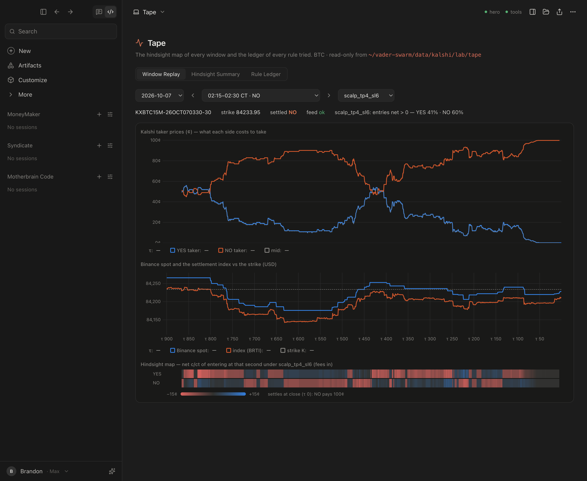

# Motherbrain Code

A desktop app modelled on the Claude Code desktop app. One window, two engines:

- **Motherbrain**: the hero on Mind (`mlx-community/Qwen3.5-397B-A17B-4bit`, OpenAI-compatible at `localhost:8100/v1`), with her sandboxed tools from mb-tools (`localhost:8140`: `code_interpreter`, `read_file`, `recall_memory`), plus one app-side tool, `spawn_claude_session`.
- **Claude Code**: the local `claude` CLI (`~/.local/bin/claude`) driven through `@anthropic-ai/claude-agent-sdk`. It uses the CLI's existing login, so it runs on the signed-in subscription. Sessions are written to `~/.claude/projects` and can be resumed from the terminal (`claude --resume <id>`).




## Architecture

```
renderer (React + Tailwind, sandboxed)            main process (Electron, Node)
  Sidebar · Transcript · Composer   <── IPC ──>    engine:send → claude.ts | motherbrain.ts
  state.ts applies EngineEvents                    engine:event (stream) ← both engines
  cards: permission / spawn  ── decision:respond → bridge.ts resolves the awaiting engine
  saveState (debounced)      ── state:save ─────→ store.ts → <userData>/state.json
```

- `shared/types.ts`: models, modes, the transcript block model, and the `EngineEvent` stream contract.
- `electron/claude.ts`: one `query()` per turn. It resumes with the session id from the previous turn's `system/init` and sets `includePartialMessages` for text deltas. Tool calls come from assistant messages and results from user messages. `canUseTool` raises an approve/deny card. `settingSources: user, project, local` means **your own permission rules and hooks apply**: pre-allowed tools run without a card, exactly as in the CLI. An AbortController handles interrupt.
- `electron/motherbrain.ts`: streaming chat with a tool loop (max 8 steps). mb-tools schemas are fetched per turn; if the server is down she runs without them and the transcript says so. Reasoning is shown as a collapsible "Thinking" block. **`spawn_claude_session(prompt, cwd, model)`** raises a card. On approval the renderer creates a new Claude Code session in the sidebar (marked ✦, with `spawnedBy`) and starts it, and Motherbrain receives the session key as the tool result.
- `electron/bridge.ts`: pending user decisions. The resolver is registered before the card is emitted.
- Persistence: projects, sessions and transcripts in `<userData>/state.json`.

## Tape panel (More → Tape)

Read-only views over the `core/tape` outputs in `~/vader-swarm/data/kalshi/lab/tape/`. Nothing is written there.

- **Window replay**: pick a day and a 15-minute window, step with ‹ ›, choose a strategy. Two charts share a τ axis: Kalshi YES/NO taker prices and mid in cents, then Binance spot and the settlement index against the dashed strike in USD. They are two charts, not one chart with two y-axes. Under them sits the hindsight strip: net c/ct of entering YES or NO at each second under that strategy, fees in, on a diverging scale clipped at ±15¢ (blue positive, red negative). Hovering over a chart shows the values at that second.
- **Hindsight summary**: for a day range, the share of entries net > 0 and the mean net c/ct, by strategy × τ bucket. `best` is the hindsight-best strategy per entry, the ceiling a perfect selector could reach.
- **Rule ledger**: every attempt in `rule_ledger.jsonl`, newest first. It re-reads when the file changes (polled every 4 s) and skips a half-written last line, so a scorer can append while the panel is open. Click a row for the full JSON. `verdict` is the ledger's own field when present; otherwise it is derived as positive (train and test both > 0) or negative.

Plumbing: `electron/tape.ts` runs `py/tape_query.py` under `~/vader-swarm/.venv/bin/python`, which uses pyarrow plus `core.tape.data.window`. Results are cached in memory per query. Per-day summaries are cached in `<userData>/tape_cache`, keyed by the oracle file's mtime, so a rebuilt day is recomputed. The ledger is read directly in Node. Charts use uPlot with the dataviz reference palette's dark steps, validated against `#1e1e1e`.

## Package

```
npm run dist         # build + electron-builder --mac dir (unsigned)
open "dist/app/mac-arm64/Motherbrain Code.app"
```

The `.app` (about 556 MB) can be launched from Finder. It bundles `py/tape_query.py` in `Resources/py`, still uses the vader-swarm venv and data on this machine, and finds the `claude` CLI through `~/.local/bin` (main.ts extends `PATH` for Finder launches). It is not signed or notarised and not installed anywhere; copying it to /Applications is a manual step.

Capture flags: `--view tape --tab replay|hindsight|ledger --size 1440x1180 --capture out.png --capture-delay 6000`.

## Run

```
npm install
npm run build        # typecheck + main + renderer
npm start            # the app
npm run dev          # vite HMR + electron
npm run smoke        # one Claude (haiku) turn + one Motherbrain turn, outside Electron
npx electron . --selftest                       # the same through the real main-process engines; the Claude turn writes .selftest_tmp and needs approval
npx electron . --demo --capture docs/v0.png     # seeded transcript → screenshot, not persisted
```

## Verified (2026-10-09, on vader-mind)

- `npm run build` is clean (typecheck of renderer and main, vite build).
- `npm run smoke`: Claude haiku replied "OK" in 2.1 s, streamed, with a new session id. The hero streamed "OK" in 12.3 s (cold; about 4 s warm).
- `--selftest`: a Claude turn in `default` mode → Write tool → permission event → approved → file written → "DONE"; the Motherbrain turn streams. A Bash `echo` ran without a card because the user settings pre-allow it, which shows those rules are applied.

## Stubbed / not yet built

- **Spawn path end to end with the hero choosing the tool**: the card → create → send path is built and compiles, but has not been exercised with a real hero tool call yet.
- Tape panel: BTC only (no asset picker yet). The replay does not overlay the ledger's rule entries on the window.
- Artifacts panel, the Customize page (currently an Engines health page), attachments (+), dictation (mic), back/forward, the header icons (terminal, folder, share), the session rename/delete menu, and project add/edit (projects are seeded: MoneyMaker, Syndicate, Motherbrain Code).
- Motherbrain history is text-only between turns: her earlier tool calls are not replayed.
- Packaging is an unsigned `--mac dir` build: no dmg, icon or notarisation. Renderer-only dependencies (react, markdown) are copied into the app's node_modules unnecessarily.

## Next

1. Tape panel: overlay a ledger rule's entries on the replay, add an ETH/asset picker, and add a per-day view of a rule's P/L.
2. Spawned-session results flowing back to Motherbrain: a `read_session(key)` tool, so she can supervise what she delegates.
3. Small-model lane: route narrow tasks to small local models through the orchestrator queue, with per-task measurement.
4. Hydra as a panel: send one prompt to several heads and show the grade side by side.
5. Sign, notarise and give the app an icon; trim renderer dependencies out of the packaged node_modules.
